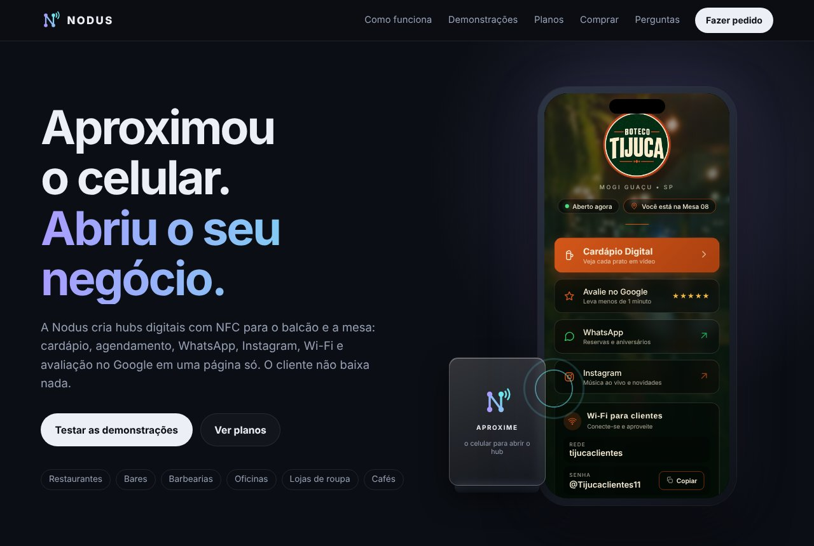
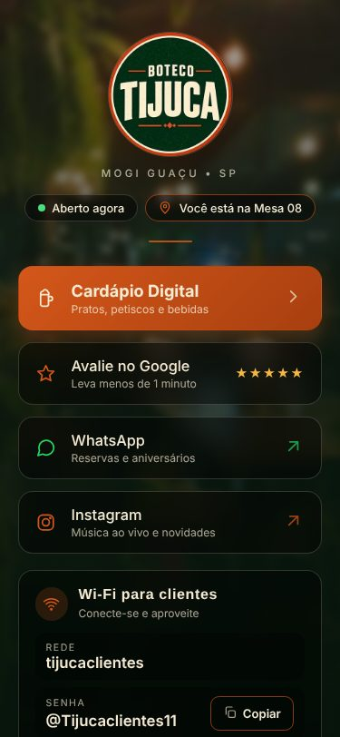
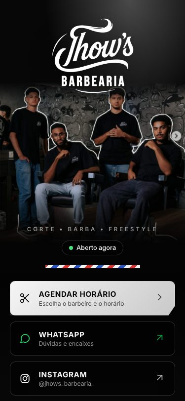
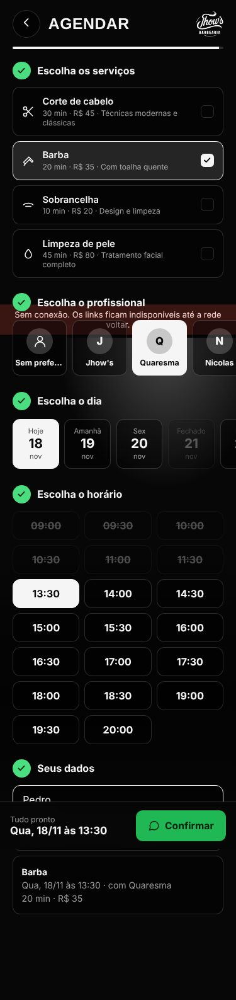
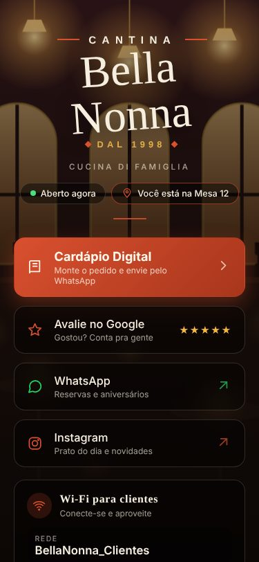
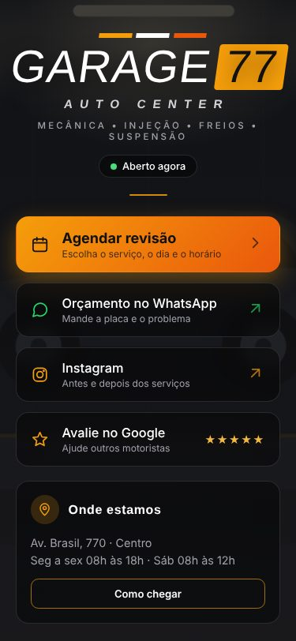
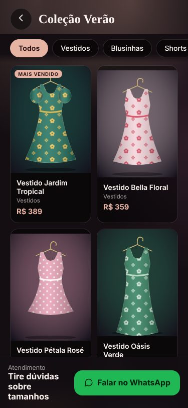
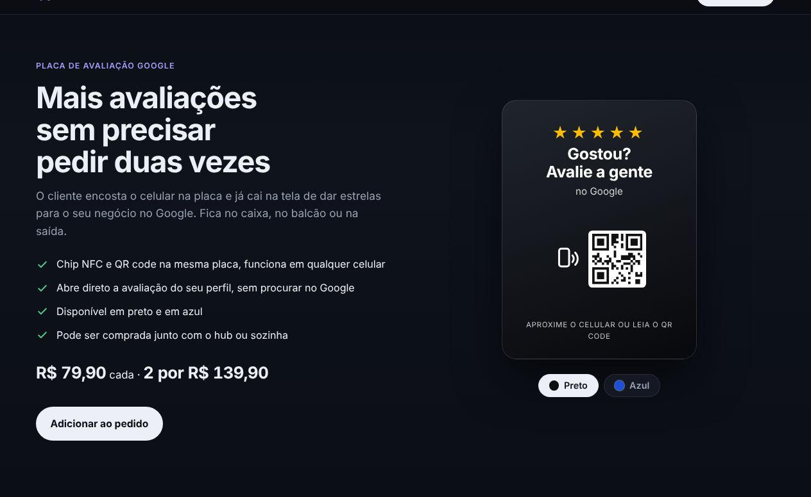
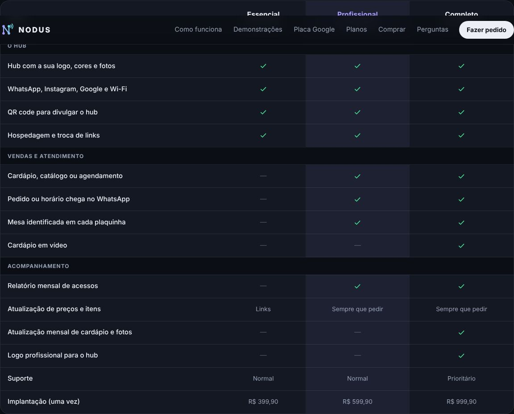

# Nodus · hubs digitais NFC para comércios locais

O cliente aproxima o celular de uma placa NFC no balcão ou na mesa e abre uma página com tudo do estabelecimento: cardápio com vídeo dos pratos, agendamento, catálogo, Wi‑Fi, WhatsApp, Instagram e avaliação no Google. Não é preciso baixar nenhum aplicativo.

**Site e demonstrações ao vivo:** https://arthurfuturedev.github.io/nodus/



## Hubs

| Boteco Tijuca (cliente) | Cardápio em vídeo | Jhow's Barbearia (cliente) | Agendamento |
|---|---|---|---|
|  |  |  |  |

| Restaurante (demo) | Oficina (demo) | Loja de roupas (demo) |
|---|---|---|
|  |  |  |

Abrir direto: [Ateliê da Moda](https://arthurfuturedev.github.io/nodus/demos/atelie.html) · [Tijuca](https://arthurfuturedev.github.io/nodus/demos/tijuca.html?mesa=08) · [Jhow's](https://arthurfuturedev.github.io/nodus/demos/jhows.html) · [Cantina Bella Nonna](https://arthurfuturedev.github.io/nodus/demos/restaurante.html?mesa=12) · [Garage 77](https://arthurfuturedev.github.io/nodus/demos/oficina.html) · [Ateliê Lis](https://arthurfuturedev.github.io/nodus/demos/loja.html)

O Boteco Tijuca, a Jhow's Barbearia e o Ateliê da Moda são clientes reais e o uso foi autorizado por eles. Os vídeos do cardápio do Tijuca foram cedidos pelo restaurante Backyard para demonstração. As demais empresas são fictícias.

## O que cada hub faz

- **Um modelo, vários negócios:** todos os hubs saem do mesmo motor (`hub/base.html`). Cada cliente é só uma configuração em JSON com cores, fontes, logo, botões e módulos.
- **Cardápio digital:** categorias, carrinho, vídeo de cada prato num player embutido (com navegação entre pratos e gesto de arrastar), pedido pelo WhatsApp e número da mesa vindo da placa (`?mesa=08`).
- **Agendamento:** escolha de serviços (mais de um), profissional, dia e horário. Respeita o expediente de cada dia, soma tempo e valor e envia o resumo pelo WhatsApp.
- **Catálogo:** filtros por categoria, ficha do produto e ilustrações vetoriais geradas por código.
- **Wi‑Fi:** mostra a rede e copia a senha com um toque.
- **Clube de assinatura:** planos mensais com botão para assinar.
- **Relatório de acessos:** registra aberturas por NFC ou QR code (`?o=nfc` / `?o=qr`), mesa, cliques em cada botão, vídeos vistos, pedidos e agendamentos, via Google Analytics 4 ou Umami. Nenhum dado pessoal é coletado.
- **Funciona em qualquer celular:** sem dependências, um único arquivo HTML com imagens embutidas e aviso de falta de conexão.

## Site de vendas

- Demonstrações ao vivo dentro de um celular na própria página, com abas por tipo de negócio.
- Planos com tabela comparativa gerada a partir de uma configuração única (`PLANOS` e `COMPARATIVO`).
- Vitrine da placa de avaliação Google com escolha de cor.
- Montador de pedido: escolhe plano e placas, calcula o total (com preço de combo) e leva ao pagamento da implantação e à assinatura mensal no Mercado Pago.

| Placa de avaliação | Comparativo dos planos |
|---|---|
|  |  |

## Estrutura

```
index.html        site de vendas (página única, sem dependências)
demos/            hubs gerados: clientes reais e demonstrações
hub/
  base.html       motor do hub (HTML, CSS e JavaScript puros)
  gerar.py        configuração dos clientes reais e geração dos arquivos
  ficticias.py    configuração das demonstrações
  dados.json      cardápios, serviços e catálogo
  img/            logos e fotos usadas nos hubs
docs/             prints usados neste README
```

## Como gerar os hubs

```bash
python3 hub/gerar.py . demos
```

Cada hub sai como um único arquivo HTML, com as imagens embutidas. No `gerar.py`, o bloco `ANALYTICS` recebe o código do relatório de cada cliente (Google Analytics 4 ou Umami). As placas são gravadas com `?o=nfc` e o QR code com `?o=qr`, para o relatório separar a origem de cada acesso.

## Tecnologias

HTML, CSS e JavaScript sem frameworks · Python para gerar os arquivos · Playwright para os testes · NFC e QR code · Mercado Pago (assinaturas) · Google Analytics 4 / Umami · GitHub Pages

---

Feito por Arthur Rodrigues Oliveira e Keni.
